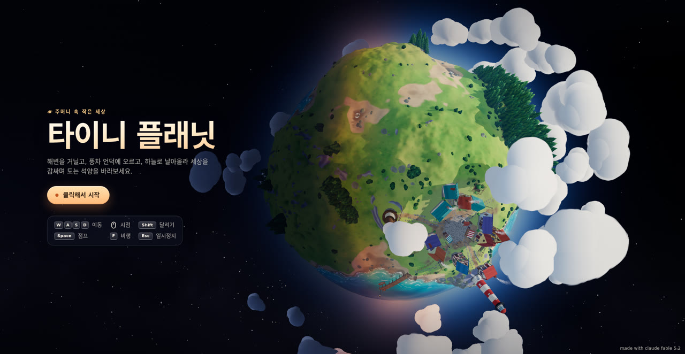
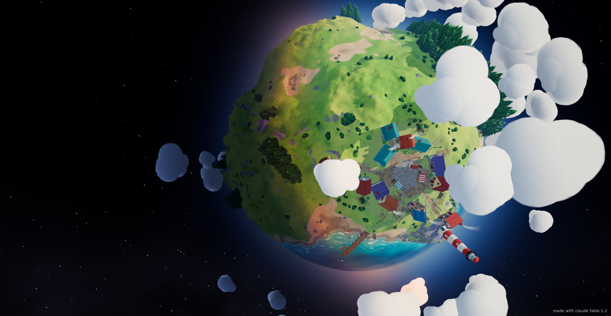

# 타이니 플래닛 (Tiny Planet) — 한국어판

브라우저에서 걷고 날아다닐 수 있는, 작고 둥근 세상. Three.js로 만든 오픈소스
[StarKnightt/tiny-planet](https://github.com/StarKnightt/tiny-planet)(MIT)의 한국어 번역판입니다.

청록색 바다와 옅은 해변, 바람에 흔들리는 초원 언덕, 소나무 숲, 조약돌 광장을 가운데 둔
열한 채의 오두막 마을, 바위 곶의 등대, 언덕 위에서 돌아가는 풍차가 있습니다. 구름이
하늘을 돌며 그림자를 드리웁니다. 중력이 행성 중심을 향해 당기기 때문에 한 바퀴를 빙 둘러
극을 넘어 출발 지점으로 돌아올 수 있습니다.

태양은 그 자리에 있고 행성이 그 아래에서 도는 세계라, 한쪽은 언제나 석양입니다.
주야 경계선을 향해 걸으면 빛이 주황으로 물들고 하늘이 분홍빛으로 변하며, 오두막 창문과
가로등이 하나둘 켜집니다. 밤쪽에서는 등대 불빛이 바다를 훑습니다.

지형, 물, 풀, 나무, 건물, 구름, 하늘, 소리까지 전부 코드로 만들어졌습니다.
다운받은 모델, 텍스처, 폰트, 오디오가 없습니다.

**플레이: https://sigco3111.github.io/tiny-planet-ko/**

키보드와 마우스가 필요합니다. 원작은 Windows + Chrome(RTX 4060)에서 만들어지고 측정되었습니다.

## 조작법

타이틀 화면을 클릭하면 시작합니다. Esc를 누르기 전까지 마우스가 화면에 고정됩니다.

| 키 | 동작 |
| --- | --- |
| W A S D / 방향키 | 걷기 |
| 마우스 | 시점 |
| Shift | 달리기 |
| Space | 점프 (비행 중에는 상승) |
| C / Ctrl | 비행 중 하강 |
| F | 비행 전환: 구름 위로 올라 행성 전체를 바라보기 |
| M | 환경음 켜기/끄기 |
| Esc | 일시정지 |

## 스크린샷

| | |
| --- | --- |
|  |  |
|  |  |

모두 한국어판 배포본에서 직접 캡처한 화면입니다.

## 기술 스택

- **Three.js 0.187** (WebGL2)과 손수 작성한 후처리 패스: HDR, MSAA, 블룸, ACES 톤 매핑,
  색 보정, 비네트, 디더.
- **TypeScript**(strict)와 **Vite**, **pnpm**. 런타임 의존성은 `three`뿐입니다.
- **그림자를 드리우는 태양 하나.** 태양 색은 픽셀마다 지역 태양 고도로 계산해서 한낮,
  석양, 밤이 행성 위에 동시에 존재합니다.
- **Web Audio** 환경음: 바람, 파도, 새 소리를 브라우저에서 합성합니다.
- **Playwright + ffmpeg(NVENC)**은 도구용: GPU 스크린샷과 1080p60 시네마틱 녹화.

## 로컬에서 실행하기

```
git clone https://github.com/sigco3111/tiny-planet-ko.git
cd tiny-planet-ko
pnpm install
pnpm dev          # http://127.0.0.1:5173/
pnpm build        # 타입 검사 후 dist/로 프로덕션 빌드
pnpm preview      # dist/ 서빙
```

빌드는 상대 base를 사용해서 `/tiny-planet-ko/` 같은 하위 경로의 GitHub Pages에서도
동작합니다. Pages는 `.github/workflows/deploy.yml`이 main에 푸시될 때마다 배포합니다.

URL 옵션: `?cinematic=1`은 20초 인트로 비행을 실시간으로 재생하고, `?debug=1`은 GPU를
로그로 남깁니다.

## 한글화 범위와 검증

- 번역: 타이틀 화면, 일시정지 화면, 조작법 안내, 모드 칩(걷기/비행/수영), 해 다이얼
  라벨(아침/한낮/오후/일출/일몰/새벽/황혼/밤), 소리 토스트, 안내 메시지, 페이지 타이틀과
  `lang="ko"`. UI에 한글 폰트 폴백(맑은 고딕, Apple SD Gothic Neo, Noto Sans KR) 추가.
- 내부 식별자(모드 이름, 화면 상태 값 등)는 원작 영문 그대로 유지하고 표시만 한글로
  바꿨습니다.
- 검증: `pnpm build`(타입 검사 포함) 통과, 배포본에서 타이틀/일시정지 화면과 한글 표시
  확인.
- 원작 고지(우하단 "made with claude fable 5.2")는 원문 그대로 유지했습니다.

## 제약 (원작 README 기준)

- **브라우저.** Windows Chrome에서만 테스트됨. Firefox와 Safari는 미검증.
- **터치 조작 없음.** 키보드와 마우스가 필요합니다.
- **영상은 저장소에 없음.** `node tools/capture.mjs`로 직접 렌더링할 수 있습니다.

## 라이선스와 원작

- 원작: [StarKnightt/tiny-planet](https://github.com/StarKnightt/tiny-planet) — MIT.
  [LICENSE](LICENSE) 참조.
- 원작 README(영문): [README.en.md](README.en.md)
- 이 저장소는 비공식 한국어 번역 포크입니다. 원작자 표시를 유지합니다.
